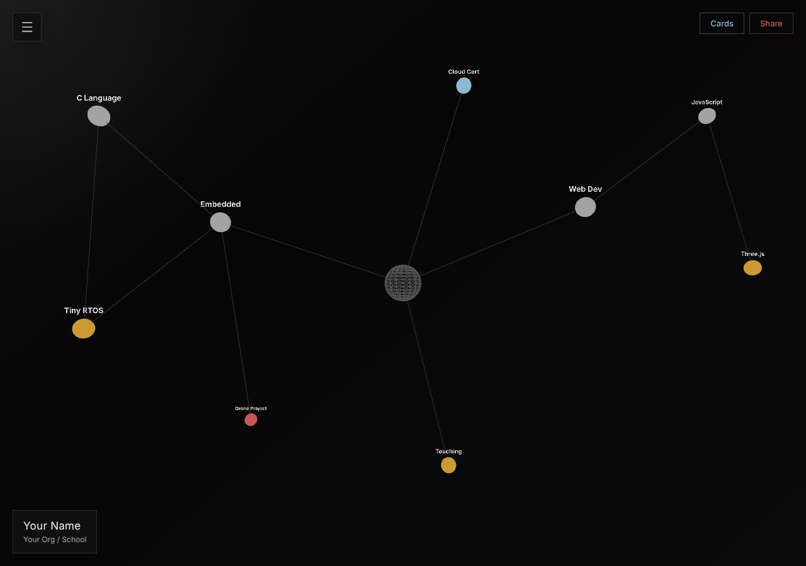
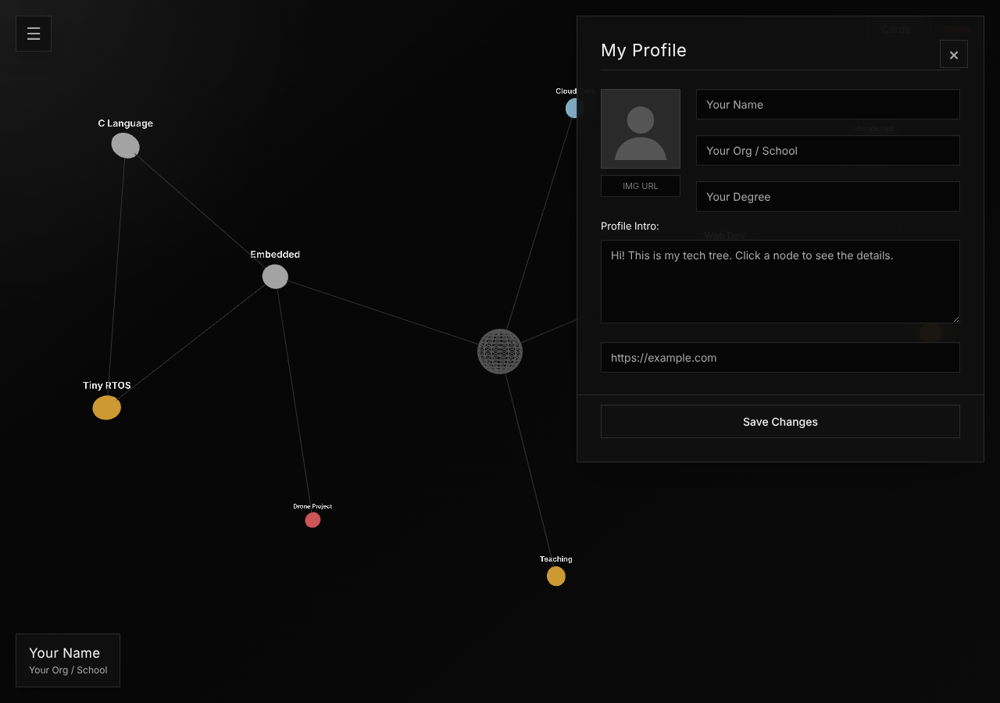
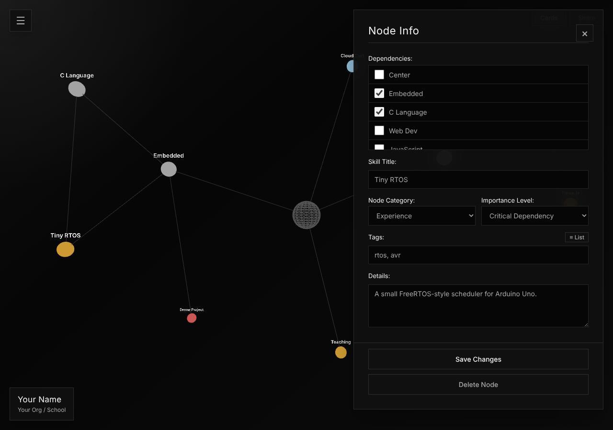
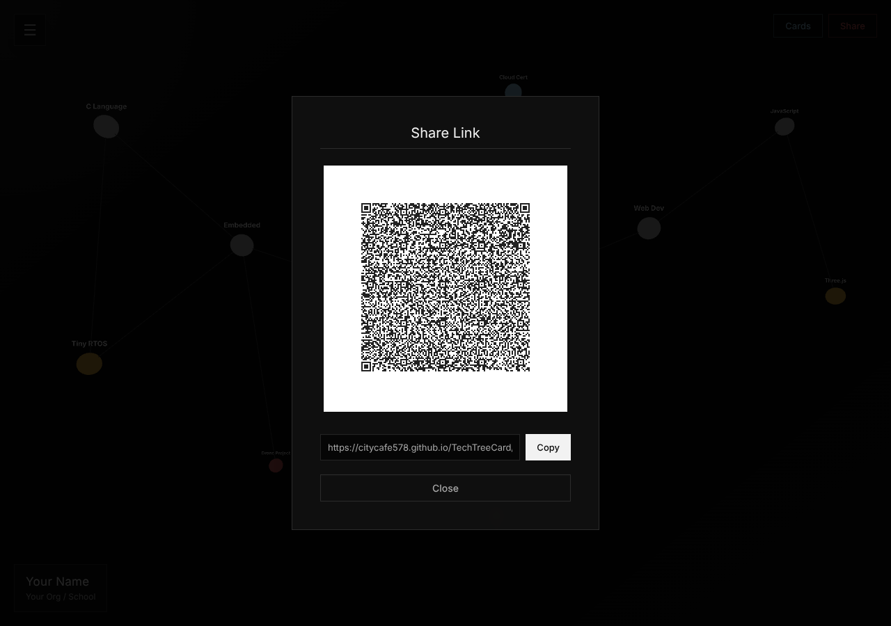
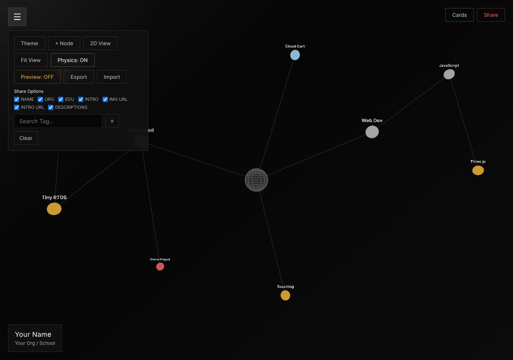
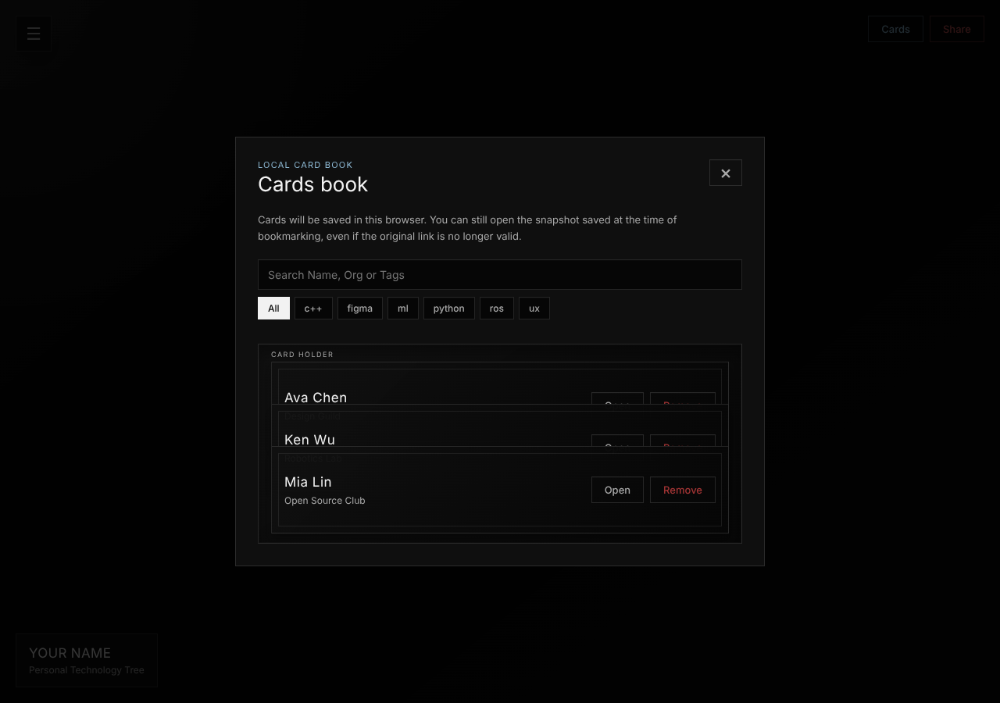

# TechTreeCard

**把你的技能變成一棵樹,用一條連結就能分享。**

[English](README.md) | 繁體中文

TechTreeCard 是一張會顯示「你的技能彼此怎麼連在一起」的名片。把你會的、做過的、正在學的都加進去,再用連結或 QR Code 整張寄出去。對方打開後可以旋轉這棵樹,點任何一個節點看詳細內容。

不用註冊帳號,也不會上傳到任何地方。你的名片存在你自己的瀏覽器裡。

**立即試用:** https://citycafe578.github.io/TechTreeCard/

---

## 快速開始

### 1. 填寫個人資料

點**中間的球體**,打開個人資料。填入姓名、單位、學歷和簡短介紹,也可以加上頭像網址和你自己的網站連結,然後按 **Save Changes**。

### 2. 加入節點

每個節點代表一件你想展示的事:一項技能、一個專案、一張證照。

1. 打開選單(左上角 **☰**),按 **+ Node**。
2. 點新的節點進行編輯,再按 **Save Changes**。

| 欄位 | 用途 |
|------|------|
| **Dependencies**(依賴) | 這個節點是建立在什麼之上。勾選 **Center**(中心)和 / 或其他節點。勾多個,就可以讓這個節點同時連到好幾個。 |
| **Skill Title** | 顯示在節點上的名稱。 |
| **Node Category**(分類) | 決定顏色:**Skills** 技能(灰)、**Experience** 經歷(琥珀)、**Credential** 證照(藍)、**Exploring** 探索中(紅)。 |
| **Importance Level**(重要度) | 決定大小:*Hello World*(小)、*Production*、*Critical Dependency*(大)。 |
| **Tags**(標籤) | 關鍵字,用逗號分隔,搜尋時會用到。 |
| **Details**(詳細說明) | 較長的說明。任何打開你名片的人都看得到。 |

要刪除節點,打開它後按 **Delete Node**。

### 3. 分享出去

按右上角的 **Share**,會得到一條連結和一個 QR Code。

按 **Copy** 複製連結,或讓對方掃 QR Code。

**分享前先決定要公開什麼。** 在選單的 **Share Options** 取消勾選你不想讓別人看到的項目(姓名、單位、學歷、簡介、頭像網址、網站連結,或節點的詳細說明)。只有勾選的內容會放進連結。

---

## 操作畫面

- **旋轉:** 拖曳(3D 檢視)。**縮放:** 滾輪或雙指。**平移:** 右鍵拖曳,或雙指。
- **點節點**就能打開。手機上不用點得很準,程式會選最靠近手指的節點。
- 如果樹有一部分跑到畫面外,打開選單按 **Fit View**。
- 在 **2D View** 中,拖曳會讓整棵樹繞著中心轉動。
- 節點會自己排開。按 **Physics: OFF** 可以讓它們停在原位。
- **2D View** 把樹攤平,**3D View** 換回立體。
- **Theme** 切換深色 / 淺色。

## 選單

| 按鈕 | 功能 |
|------|------|
| **Theme** | 切換深色 / 淺色 |
| **+ Node** | 新增節點 |
| **2D View / 3D View** | 攤平或還原 |
| **Fit View** | 調整鏡頭,讓整棵樹都在畫面內 |
| **Physics: ON / OFF** | 讓節點自己移動,或固定位置 |
| **Preview: ON / OFF** | 用對方打開連結時看到的樣子預覽自己的名片(唯讀) |
| **Export** | 把名片下載成 `.json` 檔 |
| **Import** | 載入 `.json` 名片(見「備份你的名片」) |
| **Share Options** | 選擇哪些內容放進連結 |
| **Search Tag…** | 輸入標籤後,沒有該標籤的節點會變暗。**Clear** 清除。**≡** 按鈕可以用清單顯示所有標籤。 |

## 收到別人的名片

打開別人的連結時,會以唯讀模式看到對方的名片,可以點節點看詳細內容。

要留下這張名片,按右上角的 **Save Card**(看別人的名片時,它會取代 Share 按鈕的位置)。存起來的名片會放進你的**名片夾**(右上角 **Cards** 按鈕)。

點節點會以純文字顯示詳細內容,按右上角的 **×** 可以關閉。

- 可以用姓名、單位或標籤搜尋,也可以點標籤來篩選。
- **Open** 開啟存好的名片,**Remove** 從名片夾刪除。
- 名片是以快照方式存下來的,就算原本的連結失效,還是打得開。

## 備份你的名片

你的名片只存在這個瀏覽器裡。如果清除了瀏覽器的網站資料,或是換一台裝置開啟,名片就不會在那裡。

- **Export** 會下載一個 `.json` 檔,建議偶爾備份一下。
- **Import** 會把檔案載回來。**匯入會取代你目前的名片**,想保留現有內容請先 Export。

要把名片搬到另一台裝置,可以把分享連結傳給自己,或在一台 Export、另一台 Import。

## 常見問題

**QR Code 缺少一些內容,或是沒有出現。**
QR Code 能放的資料量有限。名片太大時,QR Code 會放比較精簡的版本(先拿掉節點的詳細說明,再拿掉標籤和簡介),並在下方註明。連結裡一定是完整的內容。如果連精簡版都放不下,就只會顯示連結。

**分享時出現 "Payload too large"。**
連結會超過 12,000 個字元。請縮短一些說明、刪掉不需要的節點,或在 Share Options 取消勾選 **DESCRIPTIONS**。

**別人可以修改我的名片嗎?**
不行。打開你的連結只會看到一份複本,你自己的名片還是留在你的瀏覽器。

**它能證明我的技能是真的嗎?**
不能。它是用來呈現和分享技能的工具。名片沒有簽章也沒有驗證,任何人都可以在自己的名片上寫任何內容。

**我之前的連結現在打不開了。**
連結指向的是頁面的網址。如果頁面搬到新的網址,舊連結就會失效。

## 架設自己的版本

TechTreeCard 是一個單純的網頁,不需要建置。要發佈自己的版本:

1. 把專案放進一個 GitHub repository。
2. 開啟 **Settings → Pages**,選 **Deploy from a branch**,Branch 選 `main`、資料夾選 `/ (root)`,儲存。
3. 一兩分鐘後,你的頁面就會出現在 `https://<你的帳號>.github.io/<repo 名稱>/`。

分享連結是用頁面自己的網址產生的,所以請從發佈後的頁面分享,不要從電腦上的檔案分享。

`ssi-card-sample.json` 是範例名片,可以用 **Import** 載入試試看。
